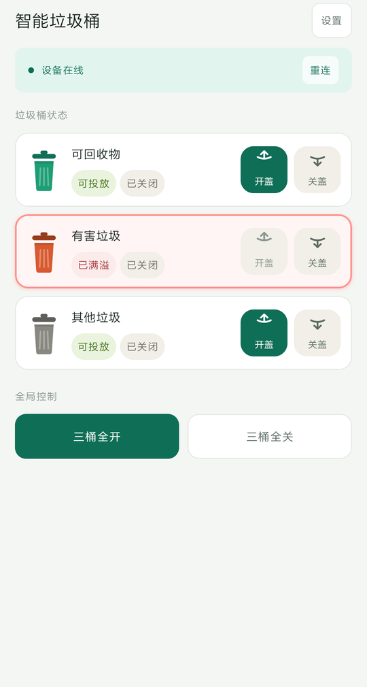
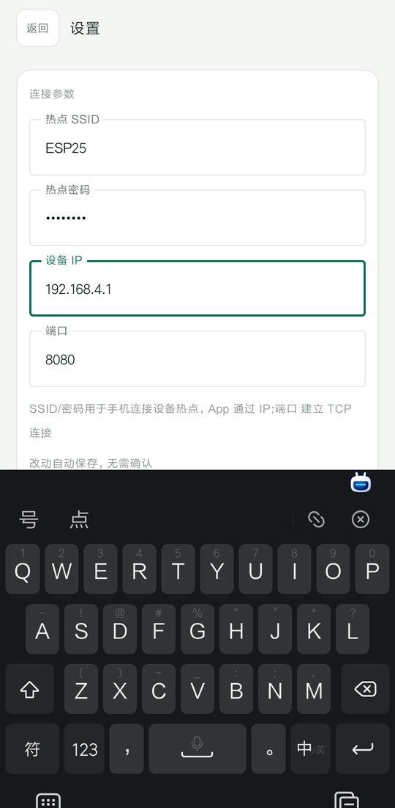

# SmartSort · 智能分类垃圾桶 Android 控制端

面向 STM32F103 + ESP8266 智能分类垃圾桶的 Android 客户端。应用通过 Wi-Fi 与设备建立单条 TCP 长连接，读取周期性状态帧并下发开合盖指令，完全适配设备现有固件，**无需修改固件代码**。

<p align="center">
  
  
  
  
  
</p>

## 界面

<p align="center">    
      
      
      
</p>

> 界面图为真机运行截图。

## 功能

| 功能      | 说明                             |
| ------- | ------------------------------ |
| 设备状态监视  | 每 500 ms 接收一帧状态报文，实时呈现三桶的可投放状态 |
| 独立开合盖   | 每个桶位配置独立开、关盖按钮，指令仅作用于目标桶       |
| 全开 / 全关 | 一键控制三桶，全开时跳过已满桶位并提示            |
| 满溢提示    | 状态帧报告满桶时，卡片切换为荧光红呼吸边框并禁用开盖     |
| 聚焦开盖    | 单桶开盖后图标原地放大至屏幕中心、盖子翻开、背景虚化     |
| 自动关盖    | 可配置的倒计时关盖（3–30 秒），支持中途「保持打开」   |
| 断线重连    | 指数退避自动重连，重连后自动恢复手动模式           |
| 设置即生效   | 连接参数与行为选项修改后自动保存，连接目标变化时自动重连   |

## 环境要求

| 项目                    | 版本                     |
| --------------------- | ---------------------- |
| JDK                   | 17                     |
| Android SDK Platform  | 34                     |
| Android Gradle Plugin | 8.5.2                  |
| Gradle                | 8.9（随仓库提供 wrapper）     |
| Kotlin                | 1.9.24                 |
| 运行设备                  | Android 8.0（API 26）及以上 |

## 构建

在仓库根目录（包含 `gradlew` 的层级）执行。Android 应用模块为 `app`。

```bash
export JAVA_HOME=/path/to/jdk-17
./gradlew :app:testDebugUnitTest :app:assembleRelease
```

产物位于 `app/build/outputs/apk/release/SmartSort-v<versionName>.apk`，体积约 0.89 MB。

开发调试包：

```bash
./gradlew :app:assembleDebug
```

> **签名说明**：本地构建若未设置签名环境变量，release 会回退到调试签名，仅供覆盖安装验证。CI 发布流程强制要求以下 Secrets，缺失时直接失败，不会产出调试签名的发布包。
>
> | Secret | 内容 |
> | --- | --- |
> | `SMARTSORT_KEYSTORE_BASE64` | 密钥库文件的 Base64 |
> | `SMARTSORT_KEYSTORE_PASSWORD` | 密钥库密码 |
> | `SMARTSORT_KEY_ALIAS` | 密钥别名 |
> | `SMARTSORT_KEY_PASSWORD` | 密钥密码 |

## 发布

版本发布由 `.github/workflows/android-release.yml` 处理：推送 `v<versionName>` 标签后，工作流校验标签与 `app/build.gradle.kts` 中的 `versionName` 一致，运行单元测试，使用 Secrets 中的密钥签名，生成 SHA-256 校验文件，并依据 `CHANGELOG.md` 创建 GitHub Release。

## 安装与联调

1. 在系统设置中连接设备热点（固件默认 SSID `ESP25`，密码 `12345678`）。
2. 安装并启动应用。应用按保存的连接目标（默认 `192.168.4.1:8080`）自动连接。
3. 顶部横幅显示「设备在线」，卡片状态随状态帧刷新即表示链路正常。

应用不代为连接 Wi-Fi（该能力需要系统级授权），设置页中的 SSID / 密码字段仅作记录用途，实际连接以系统设置为准。

```bash
adb install -r app/build/outputs/apk/release/SmartSort-v<versionName>.apk
```

## 通信协议

| 方向 | 报文                                            | 说明                                    |
| -- | --------------------------------------------- | ------------------------------------- |
| 上行 | `{"tongk":1,"tongy":0,"tongq":1,"rubbish":0}` | 每 500 ms 一帧，无分隔符；`1` 表示未满可投放，`0` 表示已满 |
| 下行 | `{"mode": 0, "gaik": 1}`                      | 冒号后必须恰好一个空格，否则固件按固定偏移取值会解析错误          |
| 握手 | `{"mode": 0}`                                 | 连接建立后立即下发，将固件从自动模式切换为手动模式             |

完整字段定义、时序与异常处理见 [docs/protocol.md](docs/protocol.md)。

## 项目结构

```text
SmartSort/
├── app/                             Android 应用模块
│   ├── build.gradle.kts             版本号、签名、构建配置
│   ├── proguard-rules.pro
│   └── src/
│       ├── main/
│       │   ├── AndroidManifest.xml
│       │   ├── java/com/smartsort/app/
│       │   │   ├── MainActivity.kt       Compose 入口
│       │   │   ├── MainViewModel.kt      状态机、倒计时、指令下发、设置提交
│       │   │   ├── data/                 协议、切帧、连接、持久化与校验
│       │   │   └── ui/                   主页、设置页、组件与主题
│       │   └── res/                      图标与基础资源
│       └── test/                     协议与切帧单元测试
├── docs/
│   ├── protocol.md                  设备通信协议
│   ├── architecture.md              架构与关键设计决策
│   ├── design.md                    交互与视觉规范
│   └── screenshots/                 界面图
├── build.gradle.kts                 插件版本声明
├── settings.gradle.kts
├── gradle.properties
├── gradlew / gradle/                Gradle 8.9 wrapper
├── .github/workflows/               持续集成与发布
└── README.md / CHANGELOG.md / CONTRIBUTING.md / LICENSE
```

## 设计要点

- **盖位由本地推断**：固件不回报实际盖位，界面依据已下发指令推断开合状态，因此不提供「盖子确实已开」的强保证。
- **在线判定**：固件不回报连接状态，应用以「TCP 已建立 + 1.5 秒内收到状态帧」作为在线条件，超时即判定掉线并进入重连。
- **满桶由客户端拦截**：固件对满桶开盖不返回失败回执，应用在状态帧提示满溢时禁用开盖按钮并给出提示，避免无效指令。
- **三桶全开不参与自动关盖**：自动关盖仅作用于单桶开盖，全开需手动全关，因此全开动作会同时取消进行中的倒计时并退出聚焦态。

更多取舍说明见 [docs/architecture.md](docs/architecture.md)。

## 兼容性

| 项目                | 说明                                                   |
| ----------------- | ---------------------------------------------------- |
| Android 8.0–11    | 可用。背景虚化（`Modifier.blur`）自 Android 12 起生效，低版本退化为半透明遮罩 |
| Android 12+       | 完整效果                                                 |
| 屏幕方向              | 锁定竖屏                                                 |
| 深色模式              | 不提供，界面固定为浅色主题                                        |
| 主题图标（Android 13+） | 未提供单色图层，使用自适应图标                                      |

## 参与贡献

提交前请阅读 [CONTRIBUTING.md](CONTRIBUTING.md)。涉及协议的改动需同时满足固件现有解析规则，不得改变报文语义。

## 许可证

[MIT](LICENSE)

## 相关项目

设备固件（STM32F103 + ESP8266）位于 [harrni/rubish\_bin](https://github.com/harrni/rubish_bin)，本仓库是其配套的 Android 控制端，独立构建、独立发布，不包含固件代码。
