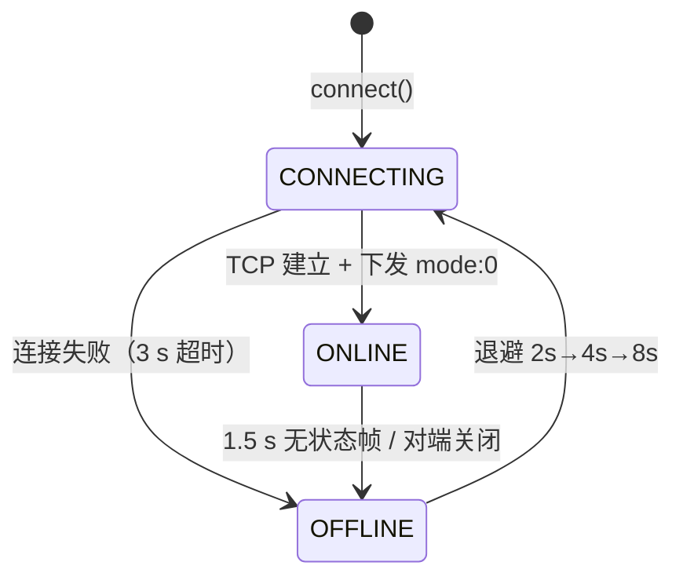

# 架构说明

## 1. 分层结构

```text
┌──────────────────────────────────────────────┐
│ UI 层（Jetpack Compose）                      │
│ AppRoot / MainScreen / SettingsScreen / 组件   │
└───────────────────┬──────────────────────────┘
                    │ UiState（StateFlow）
┌───────────────────┴──────────────────────────┐
│ 状态层（MainViewModel）                        │
│ 连接状态机 · 倒计时 · 指令下发 · 设置提交        │
└───────────────────┬──────────────────────────┘
                    │ DeviceEvent（Flow）
┌───────────────────┴──────────────────────────┐
│ 数据层（data/）                                │
│ DeviceRepository · BinProtocol · FrameSplitter │
│ SettingsStore · SettingsDraft / NetRules       │
└──────────────────────────────────────────────┘
```

单向数据流：数据层产出事件 → ViewModel 收敛为 `UiState` → Compose 依据状态渲染并回调 ViewModel。UI 层不持有连接或协议逻辑，也不直接读写存储。

## 2. 模块职责

| 文件 | 职责 |
| --- | --- |
| `MainActivity.kt` | 承载 Compose 内容，创建 ViewModel |
| `MainViewModel.kt` | 唯一状态源；连接生命周期、倒计时、指令下发的编排，设置提交与校验入口 |
| `data/DeviceRepository.kt` | TCP 连接、读循环、退避重连、指令写入；对外暴露 `Flow<DeviceEvent>` |
| `data/BinProtocol.kt` | 指令构造与状态帧解析，是协议细节的唯一落点 |
| `data/FrameSplitter.kt` | 花括号配对切帧，处理粘包与半包 |
| `data/SettingsStore.kt` | 设置持久化（SharedPreferences，读写均切至 IO 调度器） |
| `data/SettingsDraft.kt` | 编辑态草稿与字段校验规则（`NetRules`） |
| `ui/AppRoot.kt` | 主页与设置页切换、Snackbar 宿主、离开设置页时的提交 |
| `ui/MainScreen.kt` | 主页布局，挂载聚焦层 |
| `ui/components/*` | 桶位卡片、桶形图标、连接横幅、全局控制、聚焦层、倒计时按钮 |
| `ui/theme/Theme.kt` | 色板与 Material 3 主题 |

## 3. 状态模型

`UiState` 是界面唯一数据来源。

| 字段 | 类型 | 说明 |
| --- | --- | --- |
| `conn` | `ONLINE` / `CONNECTING` / `OFFLINE` | 连接态，由数据层事件驱动 |
| `bins` | `List<BinUi>` | 三桶状态：名称、是否可投放、盖位推断值 |
| `focus` | `Int?` | 当前聚焦桶位，`null` 表示未聚焦 |
| `autoClose` | `Boolean` | 是否启用自动关盖 |
| `seconds` | `Int` | 倒计时时长（3–30 秒） |
| `remain` | `Float` | 剩余秒数，100 ms 步进刷新 |
| `keepOpen` | `Boolean` | 是否已选择保持打开 |
| `host` / `port` | `String` / `Int` | 生效的连接目标 |
| `ssid` / `pwd` | `String` | 热点信息，仅作记录 |
| `lastFrame` | `String` | 最近一帧原始报文，供排查 |

`online` 为派生属性（`conn == ONLINE`），开合盖入口统一以它作为前置条件。

## 4. 线程与并发

| 关注点 | 处理方式 |
| --- | --- |
| 网络读写 | `DeviceRepository` 以 `Dispatchers.IO` 执行，读循环在协程中阻塞读取 |
| 指令写入 | `send()` 为挂起函数，内部 `Mutex` 串行化，避免多按钮并发写入交错 |
| 状态更新 | 全部通过 `MutableStateFlow.update` 完成，UI 侧 `collectAsState` 订阅 |
| 定时器 | 单个 `timerJob`，100 ms 步进；任何状态切换均先取消旧任务 |
| 存储读写 | `withContext(Dispatchers.IO)` + `commit()`，保证落盘完成后再返回 |

连接任务、倒计时任务、保存任务各自持有 `Job` 引用，切换时先取消再重建，不依赖隐式顺序。

## 5. 连接生命周期



要点：

- 连接成功后立即下发 `{"mode": 0}`，将固件切换到手动模式；此步骤失败不影响后续读循环，但开合盖指令会被固件忽略。
- 掉线与主动重连都会调用 `forceClose()`：退出聚焦态、取消倒计时、清空盖位推断。因为重连后无法得知真实盖位，保留旧的「开盖中」会造成界面与设备不一致。
- `connect()` 的顺序固定为「取消旧任务 → 关闭 socket → 重建」。关闭 socket 使阻塞读立即返回，避免旧连接在超时前继续占用链路。

## 6. 聚焦与倒计时

单桶开盖时状态迁移为：写入开盖指令 → 标记盖位推断值 → 设置 `focus` → 若启用自动关盖则启动计时。

计时仅在 `focus != null` 时启动。倒计时结束自动下发关盖并退出聚焦；用户点「保持打开」则取消计时并置 `keepOpen`，聚焦层保留手动关盖入口。

三桶全开走另一条路径：不设置 `focus`，并显式停止计时，全开后必须手动全关。该规则由 `startTimer()` 首行的 `focus == null` 守卫与 `allOpen()` 中的 `stopTimer()` 双重保证。

## 7. 设置提交链路

```text
输入 → SettingsDraft（含原始文本）→ 700 ms 防抖 → commit()
                                 ├─ 字段校验，非法值沿用上次生效值
                                 ├─ 与当前生效配置比对，无变化直接返回
                                 ├─ 落盘
                                 └─ 连接目标变化 → connect()
```

- 草稿中的 `host` / `port` 以字符串保存，避免输入过程中的半成品被提前规范化。
- 校验规则集中于 `NetRules`：IPv4 四段、每段 0–255、排除 `0.0.0.0`；端口 1–65535。
- 关闭设置页时调用 `flush()` 跳过防抖立即提交，避免「改完即返回」丢失改动。
- 仅当连接目标变化时重连；只修改 SSID、密码、自动关盖或时长不触发重连。

## 8. 关键设计决策

| 决策 | 原因 | 代价 |
| --- | --- | --- |
| 盖位由本地推断 | 固件不回报盖位 | 无法保证设备端真实状态 |
| 以「socket + 帧新鲜度」判定在线 | 固件不上报连接状态 | 网络抖动可能造成短暂误判 |
| 维持单条连接 | 固件仅处理一条链路 | 无法并行多连接 |
| 满桶在客户端拦截 | 固件对拒绝开盖无回执 | 依赖状态帧及时到达 |
| 使用 SharedPreferences 而非 DataStore | DataStore 为 6 个标量引入 protobuf 与原生库，体积代价远高于收益 | 需自行处理线程切换 |
| release 复用调试签名 | 便于覆盖安装验证 | 不适合直接上架分发 |

## 9. 体积预算

release 开启 R8 代码压缩与资源裁剪。当前产物（929,771 字节）构成如下：

| 条目 | 解压后 | 在包内占用 |
| --- | --- | --- |
| `classes.dex` | 1,668,584 B | 806,770 B |
| `resources.arsc` | 86,672 B | 86,672 B |
| 桌面图标（WebP） | 9,164 B | 9,164 B |
| `assets/dexopt/baseline.prof` | 3,293 B | 3,293 B |
| 其余（清单、Kotlin 内建等 14 项） | — | 约 23 KB |
| **合计** | — | **929,771 B** |

`classes.dex` 主体为 Compose 运行时与 Material 3，属于框架固定开销。如需进一步压缩，只能弃用 Compose 改用 View 体系，收益与改动成本不成比例，故不采纳。

## 10. 已知限制

- 盖位、连接状态、指令回执三项均无设备端确认，界面呈现为客户端推断结果。
- 背景虚化依赖 Android 12 及以上的 `Modifier.blur`，低版本退回半透明遮罩。
- 未提供深色主题；界面为固定浅色，避免与设备端 OLED 反色对比产生歧义。
- 应用不参与 Wi-Fi 连接管理，热点需在系统设置中手动接入。
