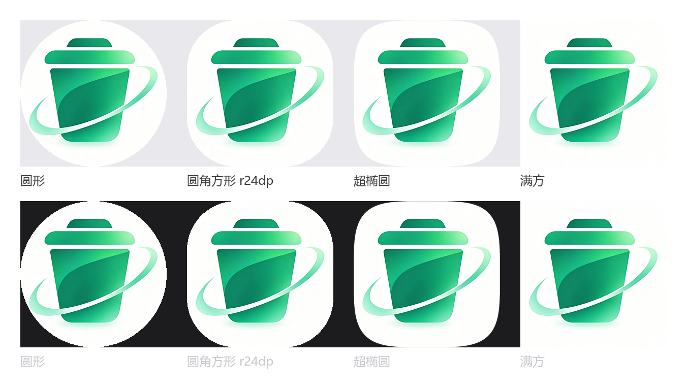

# 交互与视觉规范

本文定义界面的结构、状态表现与动效参数，作为实现与验收的共同依据。

## 1. 设计原则

- **状态可读**：设备不给回执，界面只呈现能够确定的状态，不对未知情况做确定性表述。
- **动作就近**：控制按钮与其作用的桶位处于同一卡片，减少跨区操作。
- **危险动作有阻隔**：满溢桶位直接禁用开盖，避免下发必然被拒绝的指令。
- **单色系统**：界面固定浅色，绿为主色，红色仅用于满溢，蓝色仅用于进行中。

## 2. 页面结构

主页自上而下分为四段：

| 区块 | 内容 |
| --- | --- |
| 标题栏 | 应用名「智能垃圾桶」，右侧「设置」入口 |
| 连接横幅 | 状态圆点 + 状态文案 + 「连接 / 重连」按钮 |
| 垃圾桶状态 | 三张桶位卡片，顺序为可回收物、有害垃圾、其他垃圾 |
| 全局控制 | 「三桶全开」「三桶全关」两个按钮 |

## 3. 色彩与语义

| 语义 | 前景 | 背景 |
| --- | --- | --- |
| 主色 / 主按钮 | `#FFFFFF` | `#0F6E56` |
| 页面背景 | — | `#F4F6F3` |
| 卡片 | `#14211A` | `#FFFFFF`，描边 `#E4E9E4` |
| 可投放 | `#3B6D11` | `#EAF3DE` |
| 满溢 | `#A32D2D` | `#FCEBEB`，卡片底 `#FFF5F5`，边框 `#FF3B30` |
| 开盖中 | `#185FA5` | `#E6F1FB` |
| 离线 | `#6B6A64` | `#F1EFE8` |
| 连接中 | `#854F0B` | `#FAEEDA` |

桶形识别色：可回收物 `#1D9E75`（盖 `#0F6E56`）、有害垃圾 `#D85A30`（盖 `#993C1D`）、其他垃圾 `#888780`（盖 `#5F5E5A`）。

## 4. 桶位卡片

| 元素 | 规格 |
| --- | --- |
| 圆角 | 14 dp |
| 内边距 | 横向 12 dp，纵向 11 dp |
| 桶形图标 | 38 × 46 dp，位于卡片左侧 |
| 名称 | 14 sp，600 字重 |
| 状态标签 | 10.5 sp，全圆角胶囊，横向内边距 7 dp |
| 操作按钮 | 50 × 50 dp 方形，圆角 14 dp，间距 7 dp |

操作按钮为左右并排两个大图标：左侧「开盖」为主色实心，右侧「关盖」为浅底。图标为桶口弧线加下压/上提箭头，点击区域远大于文字按钮，便于单手操作。

状态标签取值：

| 桶位状态 | 可投放标签 | 盖位标签 |
| --- | --- | --- |
| 正常、未开盖 | 可投放（绿） | 已关闭（灰） |
| 正常、已开盖 | 可投放（绿） | 开盖中（蓝） |
| 满溢 | 已满溢（红） | 已关闭（灰） |

## 5. 满溢表现

- 卡片底色切换为 `#FFF5F5`，边框加粗至 1.5 dp 并改用 `#FF3B30`；
- 外发光呼吸动画：850 ms 一次往返，透明度在 0.3–1.0 之间往返，常驻循环；
- 「开盖」按钮禁用；点击卡片开盖时提示「{桶名}已满溢，固件拒绝开盖」。

## 6. 聚焦开盖

**触发**：点击卡片主体或「开盖」按钮；三桶全开不进入聚焦。

**表现**：

1. 桶形图标由卡片原位放大并位移至屏幕中心，目标尺寸 130 × 150 dp，动画 440 ms，`FastOutSlowInEasing`；
2. 盖子绕左侧铰点翻开，旋转动画 450 ms，带轻微回弹；
3. 底层页面同时应用模糊（Android 12+，半径 5 dp），低版本以半透明遮罩替代；
4. 桶名以胶囊标签浮于桶身中部，不遮挡桶体轮廓。

**退出路径**（三种，效果一致：缩回原位、撤销模糊、按规则决定是否下发关盖）：

| 操作 | 行为 |
| --- | --- |
| 点击虚化背景 | 视为关闭，自动模式下下发关盖 |
| 点击倒计时圆环 | 立即关盖并退出聚焦 |
| 倒计时归零 | 自动下发关盖并退出 |

## 7. 倒计时与保持打开

- 环形进度以 100 ms 为步进刷新，圆环中心显示剩余秒数与「秒后关」；
- 「保持打开」取消计时，聚焦层保留单个关盖按钮，不显示圆环；
- 关闭自动关盖后，聚焦层只保留一个关盖按钮，不出现倒计时；
- 计时期间修改倒计时时长，按新时长重新计时，避免进度跳变；
- 计时期间关闭自动关盖，计时立即停止并置为保持打开状态。

## 8. 三桶全开规则

自动关盖仅作用于单个桶位。三桶全开时：

- 不弹出聚焦层，三个桶在卡片原位同时开盖；
- 不启动倒计时，任何进行中的倒计时即刻取消；
- 已满桶位不下发开盖，并在提示中列出被跳过的桶名；
- 关闭需显式点击「三桶全关」。

## 9. 离线与连接态

| 状态 | 横幅文案 | 控件 |
| --- | --- | --- |
| 在线 | 设备在线（绿点） | 全部可用，按钮显示「重连」 |
| 连接中 | 正在连接设备…（黄点） | 开合盖与全开全关禁用 |
| 离线 | 设备离线 · 手机未连接热点 {SSID} | 开合盖与全开全关禁用，按钮显示「连接」 |

离线时所有开合盖入口均提示「设备未连接，请先连接」，不发指令。

## 10. 设置页

| 区块 | 字段 |
| --- | --- |
| 连接参数 | 热点 SSID、热点密码、设备 IP、端口 |
| 自动关盖 | 开盖后自动关盖开关、倒计时时长（3–30 秒，步进 1） |
| 原始报文 | 最近一帧上行报文与下行指令示例 |

- 无「保存」按钮，字段修改后自动保存，底部提示「改动自动保存，无需确认」；
- 非法输入就地标红并给出说明，不写入存储，不触发重连；
- 仅当设备 IP 或端口变化时重连；SSID、密码、自动关盖、时长变化不重连。

## 11. 桌面图标

自适应图标，前景层与背景层均按 108 dp 画布布局。

| 层级 | 规格 |
| --- | --- |
| 画布 | 108 × 108 dp |
| 安全区 | 中心 72 × 72 dp（66.7%），图形不得越界 |
| 圆形蒙版极限 | 直径 66 dp（61%），最严格的蒙版下仍须完整可见 |
| 前景层导出 | 432 × 432 px（xxxhdpi），图形视觉半径 ≤ 141 px |
| 背景层 | 纯白 `#FFFFFF`，与前景底色一致，任何蒙版下均无接缝 |
| 存储格式 | WebP（质量 95），文件 9 KB |

图形为合盖状态的可回收物垃圾桶，不含文字，最小线宽 ≥ 3 dp，视觉重心落在几何中心。

上图为浅色与深色桌面下的四种蒙版表现，用于确认图形未被裁切、白底未露出方形边缘。

## 12. 可用性约束

- 所有可点击元素的可触控区域不小于 48 × 48 dp；
- 文案不使用「已开盖」等确定性表述，统一为「开盖中 / 已关闭 / 已下发」；
- 状态变化均有文字说明，不以颜色作为唯一区分手段。
